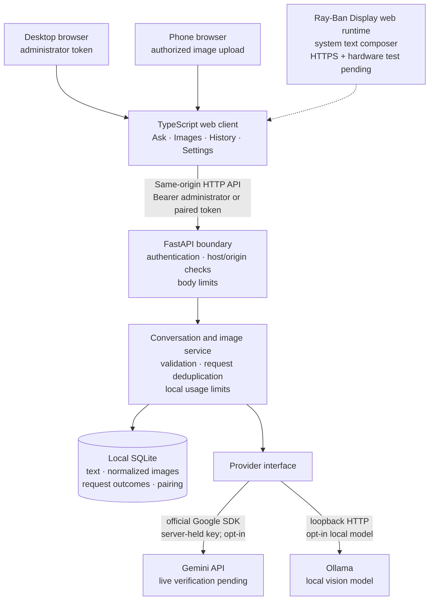

# System overview

LensAgent is a private text-and-image assistant with a web interface intended for small displays. The same interface can run on a desktop or phone. Running it on Meta Ray-Ban Display glasses requires an HTTPS endpoint. No native camera connection is included.

The dashed connection identifies the unverified device path. It is not a hidden native bridge. The local FastAPI server serves the built web files and API from one origin; it does not publish itself to the internet. See the quality report for the executed local-model checks; provider implementation, live inference and device validation are separate evidence levels.

## A question's path

1. A connected client opens or creates a conversation. On glasses, the intended input is the platform composer opened by activating the question field; desktop keyboard input is already a separate browser path.
2. The client submits text, provider choice, an optional selected image ID, and a request ID. The request ID identifies one logical attempt.
3. The API checks authorization and validation, reserves the request transactionally, enforces local limits and assembles bounded recent text context. The current selected image is attached as real bytes when present.
4. Gemini or Ollama receives the content and returns a text result. The server commits the user/assistant turns and outcome. Repeating the same request ID returns the stored outcome; changed content with that ID is rejected.
5. The client renders plain text. Model responses cannot execute browser HTML or local commands. LensAgent has no shell, repository tool execution or Codex-job endpoint.

A timeout can leave a provider outcome unknown. The application does not automatically resubmit an interrupted generation as a new billable request. Follow the visible error and retry guidance; a genuinely new attempt needs a new request ID.

## Identity and pairing

The administrator token is a local server secret, separate from the Gemini API key. An administrator can create a five-minute, one-use, eight-digit code. Redeeming it gives that browser a token valid for seven days; the database retains its hash. Browser tokens are kept in `sessionStorage`, so closing/clearing that browser context may require pairing again sooner. Server expiration and browser storage lifetime are separate limits.

All authorized devices belong to one owner and share the same conversations/images. Paired devices cannot manage other devices or create pairing codes. Revocation prevents later authenticated requests; it does not erase information already viewed or reverse an in-flight model request. This deployment does not implement multiple users with separate data. Run one server process against its database; this implementation is not a replicated or multiworker service.

## Image and conversation lifecycle

Accepted uploads are genuine single-frame JPEG, PNG or WebP, at most 5 MiB and 20 megapixels. The server decodes them, applies orientation, reduces the longest side to at most 2048 pixels and re-encodes JPEG without original metadata. HEIC needs conversion before upload. Re-encoding may reduce detail; verify dense notes, equations and diagrams remain readable.

Each conversation has an active image; an explicit selection can choose an older uploaded image. Follow-up requests can attach that same stored image again without another user upload. Only the selected image's bytes are included with a generation, although older text can discuss other images. Clearing image context makes the next question text-only. Deleting an image removes its stored bytes and references; earlier text describing it can remain. Delete the conversation to remove that text as well.

The default retention setting is seven days. Cleanup is **request-driven**, not a background timer: conversation/image/message API operations call pruning. Images expire by their creation time; conversations expire after seven days without an update. A conversation kept active can retain older text longer. Pending generation work is excluded from pruning. No scheduled cleanup runs while the server is stopped. The SQLite database is local and not encrypted by this application; operating-system access controls and any external backups remain relevant. Provider-side retention follows that provider's account terms.

There is no real-time synchronization. On a second device, refresh History and reopen the same conversation after another client uploads an image or adds messages. A new paired device may initially open its own new conversation; pairing alone does not merge chats.

## Code map

| Location | Responsibility |
| --- | --- |
| `apps/web/src/main.ts` | Client state, authenticated requests, image/history UI and pairing |
| `apps/web/index.html`, `style.css` | Semantic interface and responsive display layout |
| `apps/backend/src/lensagent/api.py` | HTTP routes, conversation orchestration and static web serving |
| `config.py`, `security.py` | Environment validation, authentication, request boundary and headers |
| `providers.py` | Provider contract, Gemini SDK adapter and local Ollama adapter |
| `images.py` | Decoding, image limits, orientation and normalization |
| `storage.py` | SQLite transactions, retention, usage, deduplication and device pairing |
| `apps/backend/tests` | Reproducible backend checks; see quality report for executed results |

The API intentionally keeps model credentials server-side, rejects arbitrary remote image fetching, restricts Ollama to loopback, and uses one SQLite-backed owner workspace. External exposure requires a separate authorized deployment with valid HTTPS and correct proxy/host configuration. See [architecture decision](architecture-decision.md) and [hardware validation](../setup/deployment.md).
