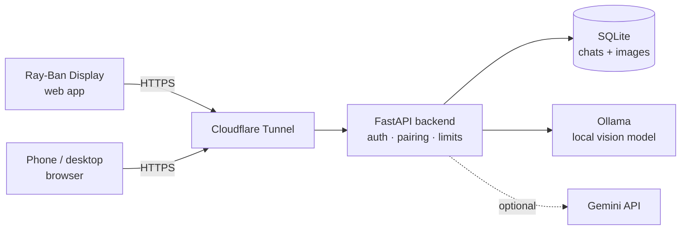

# Meta Glasses Projects

[](https://github.com/gdayoub/MetaGlassesProjects/actions/workflows/ci.yml)


Software I build for **Meta Ray-Ban Display** smart glasses.

## Lensly: a private AI assistant for smart glasses

**[Lensly](Lensly/)** lets you ask an AI questions from your glasses, using
handwriting or voice through the Neural Band, and ask about images you've
uploaded. Answers appear in your field of view. Inference runs on **your own
GPU** through Ollama, so conversations and photos never leave your machine
unless you opt into Gemini.



### Highlights

- **Runs on real hardware.** It's deployed as a Display web app and has been tested on Ray-Ban Display glasses, an iPhone and a desktop.
- **Local-first AI.** Vision questions run on a self-hosted multimodal model (Qwen3-VL 8B / Gemma 3 via Ollama). Providers are pluggable, with Gemini as an opt-in cloud fallback.
- **Security by design.**
  - Bearer-token API with one-time 8-digit pairing codes and revocable per-device tokens.
  - Exact host and origin allow-lists, with the backend bound to loopback and exposed only through a tunnel.
  - Uploads are decoded, stripped of metadata and re-encoded before storage.
  - An [independent security review](Lensly/docs/quality/security-review.md) found and fixed real bugs.
- **Reliable under failure.** Idempotent request IDs mean a dropped connection never double-charges or duplicates an answer, and timeouts surface as explicit "unknown outcome" states.
- **Built for a 600×600 display.** Semantic controls let the glasses' system text composer and spatial navigation work natively. The design uses a high-contrast black UI because the display adds light to the real scene.
- **Tested.** CI runs Ruff, strict mypy, 29 backend tests (pytest), and Playwright end-to-end browser tests on every push.

### Engineering process

Before writing code, I researched the platform and compared five
integration paths: a Messenger bot, an Instagram bot, a Display web app, a
native companion app, and a hybrid. The comparison is documented in a
[decision matrix](Lensly/docs/architecture/architecture-decision.md).
Research notes cover [Meta's platform constraints](Lensly/docs/research/meta-platform.md),
[model selection](Lensly/docs/research/ai-models.md) and
[existing open-source projects](Lensly/docs/research/github-landscape.md).

### Tech stack

**Backend:** Python 3.12, FastAPI, SQLite, Pillow, httpx, uv ·
**Frontend:** vanilla TypeScript (strict), Playwright ·
**AI:** Ollama (Qwen3-VL, Gemma 3), Google Gemini SDK ·
**Infra:** Cloudflare Tunnel, GitHub Actions

### Run it

```powershell
cd Lensly
.\scripts\setup.ps1
.\scripts\start.ps1    # → http://127.0.0.1:8765
```

See the **[Lensly guide](Lensly/README.md)** for model setup, glasses
pairing, deployment and troubleshooting.

## Author

**George Dayoub**: [GitHub](https://github.com/gdayoub) · [Portfolio](https://george-dayoub-portfolio.vercel.app)

## License

[MIT](LICENSE)
